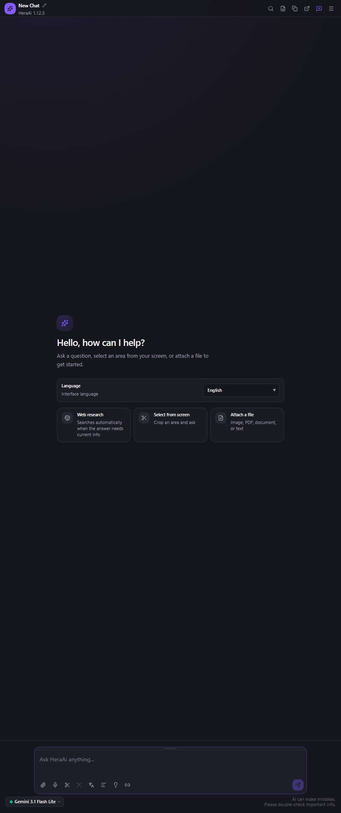
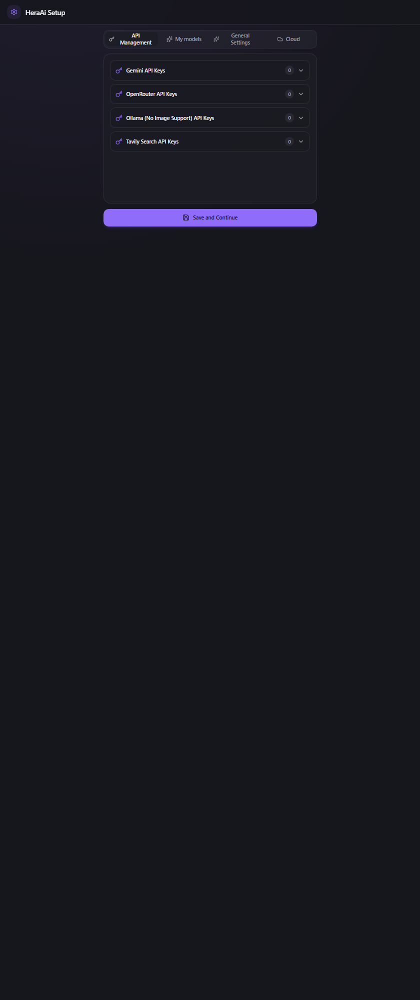
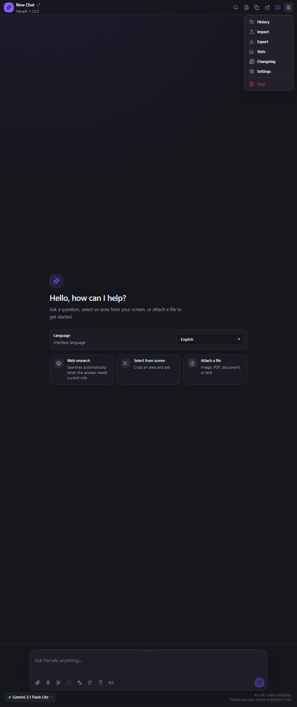
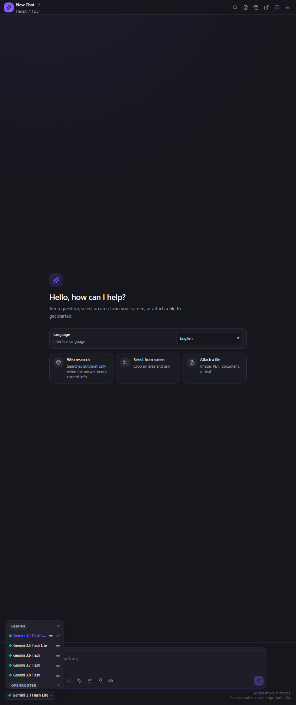
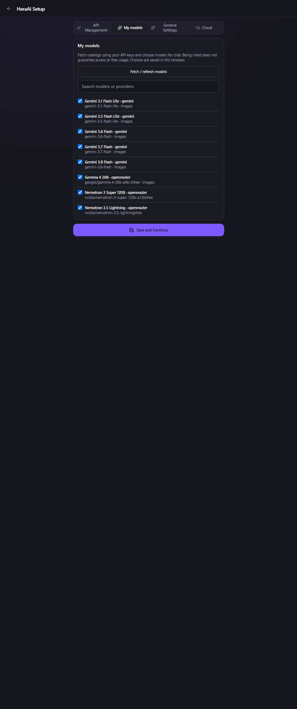
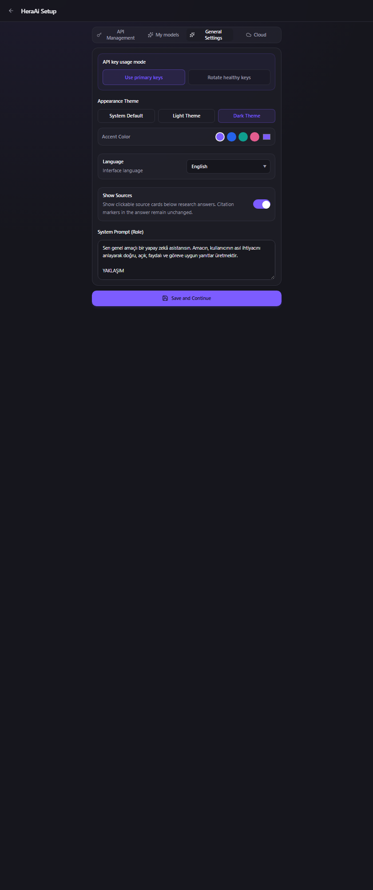

# HeraAi — Chrome Yan Panel'de özel yapay zekâ asistanı

> English: [README.md](./README.md)

**Anahtarın olan bütün modeller, okuduğun sayfanın yanındaki panelde.**

HeraAi Chrome Yan Panel'de yaşar. Gemini, OpenRouter Free ve Ollama Cloud ile sohbet eder, Tavily ile web araştırması yapar, ekrandan bir alan kırpar, dosya ekler ve sesli girdi alır. API anahtarları cihazda şifreli bir IndexedDB kasasında tutulur. İsteğe bağlı Google girişi, uçtan uca şifrelenmiş verileri Firebase/Firestore üzerinden eşitler.



---

## İçindekiler

- [Ne yapar](#ne-yapar)
- [Ekranlar, tek tek](#ekranlar-tek-tek)
  - [1. Sohbet](#1-sohbet)
  - [2. Kurulum — API anahtarları](#2-kurulum--api-anahtarları)
  - [3. Ana ekran ve menü](#3-ana-ekran-ve-menü)
  - [4. Model seçici](#4-model-seçici)
  - [5. Modellerim](#5-modellerim)
  - [6. Genel ayarlar](#6-genel-ayarlar)
- [Kurulum](#kaynaktan-derleme)
- [Sağlayıcılar ve modeller](#sağlayıcılar-ve-modeller)
- [Anahtar yönetimi](#anahtar-yönetimi)
- [Gizlilik ve isteğe bağlı bulut](#gizlilik-ve-isteğe-bağlı-bulut)
- [Kaynaktan derleme](#kaynaktan-derleme)
- [Bilinen sınırlar](#bilinen-sınırlar)
- [Lisans](#lisans)

---

## Ne yapar

| Yetenek | Ayrıntı |
|---|---|
| **Yan panel** | okuduğun sayfanın yanında açık kalır; sayfayı kapatmaz |
| **Üç sağlayıcı** | Gemini (5 model), OpenRouter Free (3 model), Ollama Cloud (GPT-OSS 120B, Nemotron 3 Super, Gemma 4 31B) |
| **Akan sohbet** | Gemini ve OpenRouter'da SSE, Ollama'da NDJSON |
| **Görsel girdi** | görseller ve PDF sayfaları satır içi, ayrıca ekran alanı yakalama |
| **URL Context** | herkese açık bir sayfayı kazımak yerine doğrudan okur |
| **Tavily yedeği** | URL Context sayfaya ulaşamadığında web arama ve sayfa çıkarma |
| **Anahtar rotasyonu** | ana anahtar veya dengeli rotasyon; otomatik geçiş, dinlenme ve yeniden deneme saati |
| **Model kataloğu** | kendi anahtarlarının gördüğü modelleri getir, sohbet seçicisinde hangileri görünsün sen seç |
| **Yerel kasa** | anahtarlar cihazda IndexedDB içinde şifreli |
| **İsteğe bağlı eşitleme** | Google girişi, uçtan uca şifreli, Firebase/Firestore üzerinden |
| **Arayüz** | 13 dil, açık / koyu / sistem |

---

## Ekranlar, tek tek

### 1. Sohbet


Ana yüzey, yan panel boyutuna göre.

- **Başlık** — oturum adı, yeniden adlandırma, sohbet içinde arama, Markdown olarak dışa aktarma, bütün sohbeti kopyalama, tam sayfada açma, yeni sohbet ve *daha fazla* menüsü.
- **Karşılama** — `Merhaba, nasıl yardımcı olabilirim?` ve üç başlangıç kartı: **Web araştırması** (Tavily), **Ekrandan seç** (alan kırp ve sor), **Dosya ekle** (görsel, PDF, belge veya metin).
- **Yazı alanı** — mesaj kutusu ve ekleme, sesli giriş, ekrandan alan seçme, ekli görselden OCR, seçileni çevirme ve gönderme araçları.
- **Alt çubuk** — etkin model rozeti (`Gemini 3.1 Flash Lite`, `GEMINI` etiketiyle) ve yapay zekânın hata yapabileceği, önemli bilgilerin kontrol edilmesi gerektiği notu.

Panel bilerek dar: tek sütun, tek yazı alanı, yer için yarışan yan çubuk yok.

### 2. Kurulum — API anahtarları



İlk açılış anahtar ister, sağlayıcı başına bir satır: **Gemini**, **OpenRouter**, **Ollama (görsel desteklemez)**, **Tavily arama**.

Her satır kaç anahtar kayıtlı olduğunu gösterir (ekleyene kadar `0`) ve sağlayıcı başına birden çok anahtar kabul eder. `Kaydet ve Devam Et` kaydeder ve devam eder.

Bu adım tamamlanmadan hiçbir şey çalışmaz — uygulama yanında anahtar taşımaz ve başkasının hesabı üzerinden aracılık yapmaz.

### 3. Ana ekran ve menü



Başlıktan açılan *daha fazla* menüsü:

| Öğe | Ne yapar |
|---|---|
| **Yeni Sohbet** | yeni oturum başlatır |
| **Geçmiş** | sohbet geçmişi katmanı |
| **İçe Aktar** / **Dışa Aktar** | sohbet alır veya verir |
| **İstatistik** | kullanım istatistikleri |
| **Yama Notları** | sürüm notları |
| **Ayarlar** | ayar paneli |
| **Temizle** | onaylı toplu silme |

### 4. Model seçici



Alttaki rozet seçiciyi açar. Modeller sağlayıcıya göre gruplanır — önce `GEMINI`, sonra `OPENROUTER`, sonra `OLLAMA` — ve her giriş model adını ve görsel kabul edip etmediğini (kamera simgesi) gösterir.

Model seçmek sonraki mesaj için etkin sağlayıcıyı değiştirir. Seçici yalnız *Modellerim*'de açtığın modelleri listeler, bu yüzden kısa kalır.

### 5. Modellerim



Katalog görünümü, Kurulum içinde.

`Modelleri getir / yenile` her sağlayıcıya anahtarlarının gerçekte ne gördüğünü sorar, sonra sonucu model başına bir onay kutusuyla listeler: ad, sağlayıcı ve API kimliği (`gemini-3.5-flash-lite`, `google/gemma-4-26b-a4b-it:free`, `nvidia/nemotron-3-super-120b-a12b:free`), ayrıca görsel destek için kamera işareti.

Listenin üstündeki not dürüst: *"Listeye girmesi erişim veya ücretsiz kullanım garantisi değildir."* Katalogda görünmek, hesabın onu kullanabildiği veya ücretsiz kaldığı anlamına gelmez. Seçimler yalnız bu tarayıcıya kaydedilir.

### 6. Genel ayarlar



- **API anahtarı kullanım biçimi** — `Ana anahtarları kullan` veya `Anahtarları sırayla kullan`.
- **Görünüm** — `Sistem Varsayılanı`, `Açık Tema`, `Koyu Tema`, ayrıca vurgu rengi seçici.
- **Dil** — tüm arayüz için 13 dil.
- **Kaynakları göster** — araştırma cevabının kaynak kartlarını gösterip göstermeyeceği.
- **Sistem komutu** — her konuşmayla gönderilen temel talimat (`Sen genel amaçlı bir yapay zekâ asistanısın…`). Düzenlemek asistanın senin hesabındaki varsayılan davranışını değiştirir, başkasınınkini değil.

`Kaydet ve Devam Et` değişiklikleri uygular.

---

## Sağlayıcılar ve modeller

| Sağlayıcı | Modeller | Akış | Görsel |
|---|---|---|---|
| **Gemini** | 5 (3.1 Flash Lite → 3.8 Flash) | SSE | evet, görsel ve PDF sayfası |
| **OpenRouter Free** | 2 | SSE | evet |
| **Ollama Cloud** | GPT-OSS 120B, Nemotron 3 Super, Gemma 4 31B | NDJSON | hayır |

Ayrıca **Tavily**: URL Context bir sayfaya ulaşamadığında web arama ve sayfa çıkarma.

## Anahtar yönetimi

- Anahtarlar cihazda **şifreli IndexedDB kasasında** durur.
- Sağlayıcı başına birden çok anahtar desteklenir.
- **Ana anahtar modu** her zaman ilkini kullanır. **Rotasyon modu** listeyi gezer, böylece bir anahtarın kotası oturumu tıkamaz.
- Hata veren anahtar görünür bir geri sayımla dinlenmeye alınır; sıradaki devralır.
- Bir kez başarısız olan istek sessizce ücretli bir yola tekrar gönderilmez.

## Gizlilik ve isteğe bağlı bulut

- Anahtar ekleyene kadar hiçbir yere istek gitmez. Gömülü anahtar yok, aracı hesap yok.
- Varsayılan kurulumda sohbetler ve anahtarlar cihazda kalır.
- **Google girişi isteğe bağlıdır.** Açıldığında uçtan uca şifrelenmiş veri Firebase/Firestore üzerinden eşitlenir — sunucu şifreli metni saklar, düz sohbetlerini değil.
- Ekran kırpmaları ve dosyalar yalnız o mesaj için seçtiğin sağlayıcıya gönderilir.

## Kaynaktan derleme

```powershell
npm install
npm run build          # dist/ altına üretim derlemesi
npm run package        # derleme + mağaza için uzantı zip'i
```

Sonra derlenen klasörü paketsiz uzantı olarak yükle:

1. `chrome://extensions` → **Geliştirici modu**nu aç.
2. `Paketsiz yükle` → `dist/` klasörünü seç.
3. Yan paneli araç çubuğundan aç.

Testler:

```powershell
npx vitest run
```

## Bilinen sınırlar

- **Ollama görsel desteklemez** — Kurulum'da böyle işaretlidir ve yazı alanının görsel araçları onun için sunulmaz.
- Ücretsiz modeller hız sınırlıdır ve kullanılabilirlikleri değişir; katalog bir anlık görüntüdür, vaat değil.
- İsteğe bağlı bulut canlı bir Firebase projesi ister; ücretsiz katmanın ötesi için faturalandırma gerekir. Yerel yol ikisini de istemez.
- Eşitleme uçtan uca şifreli olduğu için kaybolan bir parola sunucu tarafından kurtarılamaz.

## Lisans

MIT — bkz. [LICENSE](./LICENSE).
